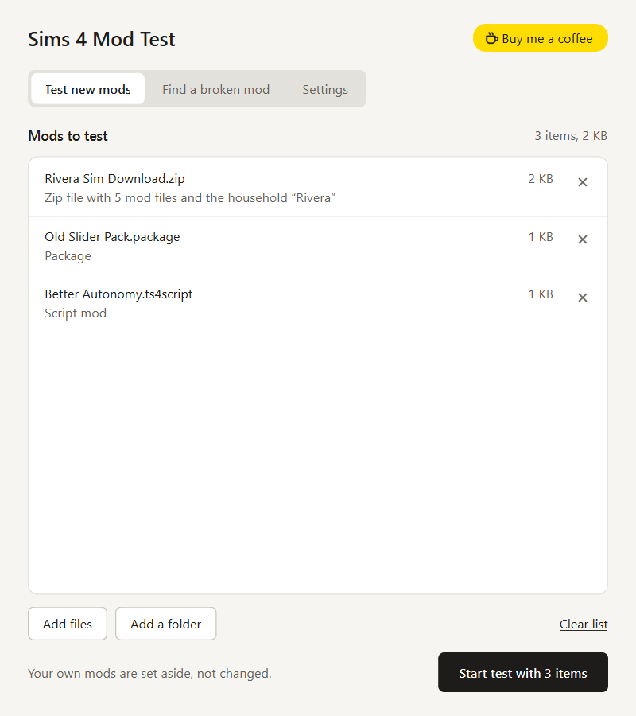
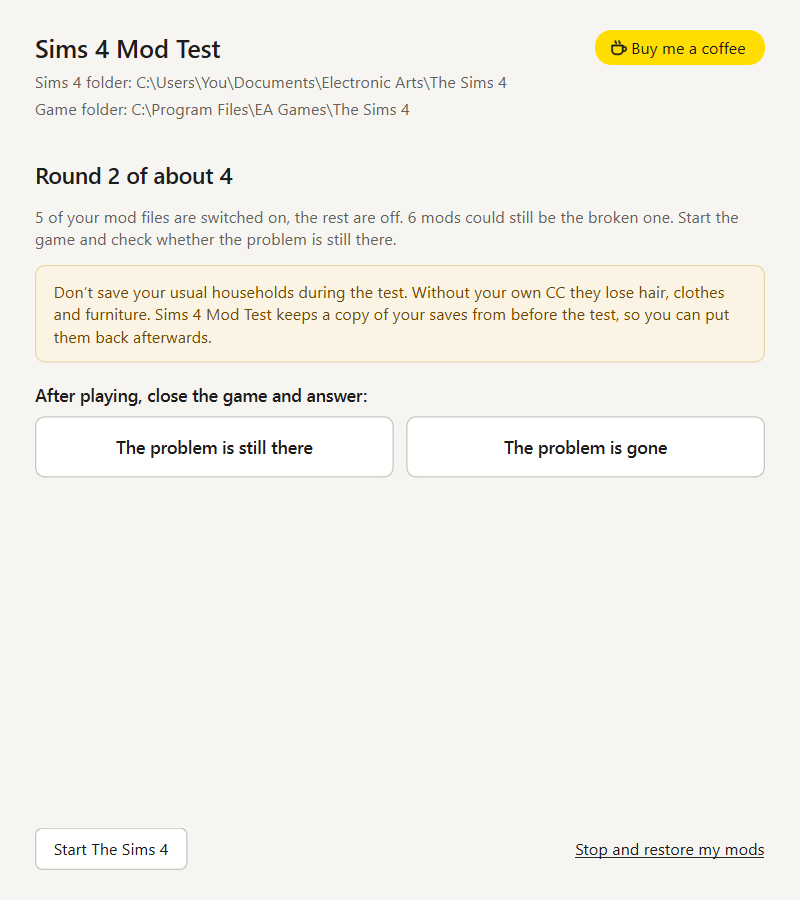

# Sims 4 Mod Test

Try Sims 4 mods on their own, find the mod that breaks your game, and put everything back with one click.
For Windows, macOS and Linux.

<a href="https://buymeacoffee.com/stixe"></a>

 

## Download

From [Releases](../../releases/latest):

- **Windows:** `Sims-4-Mod-Test-…-setup.exe`. The installer isn't signed yet, so Windows may say
  "Windows protected your PC". Click **More info**, then **Run anyway**. If Smart App Control blocks it with no
  such button, use the portable zip instead. The portable zip also works if you'd rather not install.
- **macOS** (Apple silicon; Intel Macs aren't supported): `Sims-4-Mod-Test-…-macos.zip`. Unzip it and move the app
  to Applications. The app isn't signed by Apple, so the first time macOS refuses to open it. Open **System
  Settings → Privacy & Security**, scroll down and click **Open Anyway** next to Sims 4 Mod Test. If macOS says the
  app "is damaged", run `xattr -dr com.apple.quarantine "/Applications/Sims 4 Mod Test.app"` in Terminal once. If
  the app can't find your Sims 4 folder, allow it under **Privacy & Security → Files and Folders**.
- **Linux** (The Sims 4 through Steam with Proton): `Sims-4-Mod-Test-…-linux-x86_64.tar.gz`. Unpack it and run
  `Sims 4 Mod Test` inside the unpacked folder. On a minimal system you may need Qt's libraries first; on Ubuntu or
  Debian: `sudo apt install libegl1 libxkbcommon-x11-0 libxcb-cursor0 libfontconfig1 libdbus-1-3`. On a Steam Deck
  (desktop mode) skip that line; if the app doesn't open, start it from Konsole to see why.

The app tells you when a new version is out. Installing a new version over the old one keeps a running test, your settings and your save backups.

## Test new mods

1. Drag in what you want to try: packages, script mods, tray files, folders or `.zip` downloads.
2. Press **Start test**. Your own Mods (and Tray, if the test has Sims or lots) are set aside, and a fresh folder
   with only the test files takes their place.
3. Press **Start The Sims 4** and play.
4. Close the game and press **Restore my mods**.

Sims 4 Mod Test warns about files that change the game's own sliders (the usual cause of tiny heads). If the game
writes an error report, it tells you which mod it mentions, and whether that mod was made before the last game
update.

## Find a broken mod

Sims 4 Mod Test first switches all your mods off, then half of them at a time. After each round you close the game and
say whether the problem is still there. A few thousand mods take about 12 rounds. At the end, **Restore without it**
moves the broken mod to `Mods removed by Sims 4 Mod Test`, so nothing is lost.

## Your files are safe

- Files you add are copied, never moved or changed.
- Your save files are backed up before each test. If the game saved over one, you can put the old one back.
- If the app or your computer stops halfway, the next start puts your folders back.
- During a test, a `READ ME - Sims 4 Mod Test.txt` sits in your Sims 4 folder, in case you forget the test is
  running. Uninstalling isn't possible until you've restored your mods.
- The Sims 4 folder and the game folder are found by themselves, and you can pick either one in **Settings**.
  Settings also has light and dark mode, and lets you turn the save backup, the thumbnail-cache cleanup, starting
  the game by itself and the update check on or off.
- Uninstalling leaves the app's data folder (with your save backups) in place; Settings → About opens it. See
  [SECURITY.md](SECURITY.md) for exactly what the app touches.

## Build it yourself

You need Python 3.12.

```
python -m venv .venv
.venv/Scripts/python -m pip install -r requirements-dev.txt    # macOS/Linux: .venv/bin/python
.venv/Scripts/python app.py                                    # run it from source
.venv/Scripts/python -m pytest -q tests
.venv/Scripts/python packaging/build.py                        # the downloads, in dist/
```

The Windows installer needs [Inno Setup 6](https://jrsoftware.org/isinfo.php).

## License

[MIT](LICENSE). The downloads include other open source parts under their own licenses; see
[THIRD-PARTY-NOTICES.md](THIRD-PARTY-NOTICES.md).

Sims 4 Mod Test is a fan-made tool. It is not made by, affiliated with or endorsed by Electronic Arts or Maxis.
The Sims is a trademark of Electronic Arts Inc.
